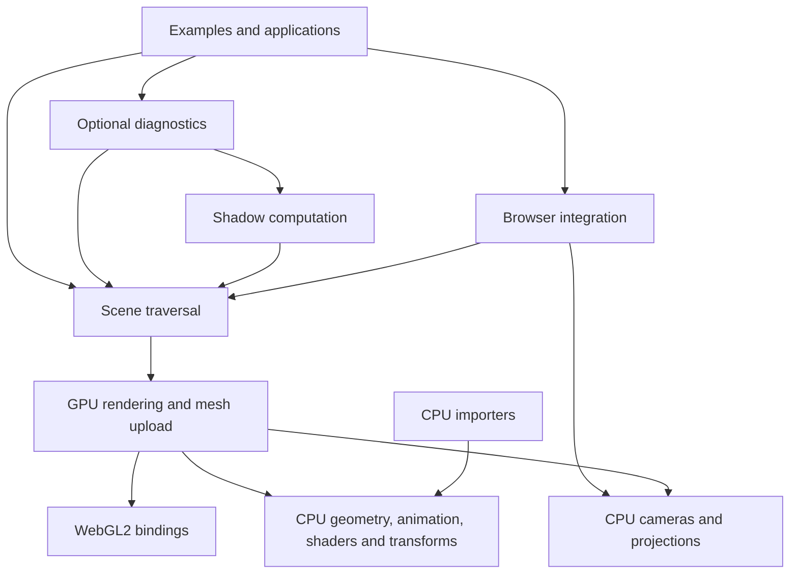

# Classes and architecture

ChronosGL 5 separates CPU mathematics and data from browser rendering. Import
supported modules from `package:chronosgl/`; paths under `src/` are implementation
details. `chronosgl.dart` combines the browser engine modules. Diagnostics use a
separate `debug.dart` import.

This guide describes the supported API. It is maintained alongside the code;
`dart doc --output=build/api` generates the detailed API reference.

## Modules and dependency direction

| Module | Responsibility | Runtime |
| --- | --- | --- |
| `core.dart` | Affine `Transform`, immutable `Color`, palette | VM and browser |
| `camera.dart` | Camera pose, view matrices, perspective and orthographic projections | VM and browser |
| `geometry.dart` | Editable CPU geometry, shape generators, polygon algorithms | VM and browser |
| `animation.dart` | Skeletons, animation tracks and pose evaluation | VM and browser |
| `importers.dart` | Parse models into CPU geometry and animation data | VM and browser |
| `shaders.dart` | Shader stages, interface descriptions, canonical names and GLSL generation | VM and browser |
| `webgl.dart` | WebGL2 context operations, handles and numeric constants | Browser |
| `render.dart`, `mesh.dart` | GPU programs, mesh upload, materials, textures, framebuffer and lighting | Browser |
| `scene.dart` | Scene links, traversal, batches and passes | Browser |
| `shadows.dart` | Shadow map computation | Browser |
| `web.dart` | Input, controls, canvas sizing and URL/media loading | Browser |
| `debug.dart` | Optional panels and visualizers | Browser |
| `example/shared/` | Demo artwork, particles, shaders and page teardown policy | Examples only |

Arrows below point from a consumer to the components it uses:

The CPU modules never import DOM, WebGL or `dart:js_interop`, directly or
transitively. Rendering adapts a mathematical camera through `CameraUniforms`;
the camera does not know about uniforms, input or the canvas. Browser integration
and diagnostics depend on engine components. Engine modules do not import
examples or allocate diagnostic assets that are never used. Several browser
facades still share the internal `src/core/lib.dart` implementation library;
the public module boundaries do not imply a separate implementation library
for every facade.

## Transforms, cameras and projections

`Transform` stores an affine local-to-parent matrix. TRS composition is
`translation * rotation * scale`, and scene traversal computes
`parentWorld * local`. Matrix and component getters return independent snapshots.
Use `setMatrix()` to apply an edited matrix and `copyMatrixInto()` to copy the
current matrix into caller-owned storage. A matrix imported with shear or a
collapsed axis retains its affine form. Check `hasTRS` before reading or editing
its rotation or scale, or use `setTRS()` to replace it with explicit components.

`Camera` stores a world-space eye position and normalized orientation. It looks
along local -Z with +Y up and has no scale or scene parent. `worldMatrix` maps
camera-local coordinates to world coordinates; `viewMatrix` is its inverse.
`lookAt(target)` preserves the eye position and changes orientation. Vector,
quaternion and matrix getters return snapshots; changes use setters and take
effect immediately.

`PerspectiveCamera` uses a full vertical `fovYRadians`, an aspect ratio and
`0 < near < far`. `OrthographicCamera` uses ordered left/right, bottom/top and
near/far bounds, allowing signed depth distances. `PerspectiveProjection` and
`OrthographicProjection` are immutable mathematical values reusable by cameras
and shadow calculations. Angles are radians and distances use scene units.

`CameraUniforms(camera)` exposes current `projection * view` and world eye
position to rendering. Reads do not change the camera. Object/model transforms
remain separate. Legacy `Spatial` retains a writable local pose for scene
objects; it is not the new camera abstraction. Its view calculation uses
separate inverse storage. See [camera migration](MIGRATION.md#camera-semantics-and-resource-lifetimes).

## Geometry and GPU rendering

`GeometryBuilder` contains editable CPU positions, attributes and faces. Call
`validate()` after editing it. CPU factories such as `cubeGeometry` require no
browser. `uploadGeometry` and `uploadWireframeGeometry` create independent GPU
meshes; `shapeCube`, `shapeCylinder`, `shapeGrid` and other `shape*` factories
combine CPU generation and upload.

`GpuMesh` owns its VAO and uploaded buffers. `attributeLayout` records attribute
bindings; `isCompatibleWith(program)` checks context and layout before sharing
a mesh. Externally supplied buffers are borrowed unless explicitly transferred.
`clearData()` releases storage while keeping the mesh reusable; `dispose()`
ends its lifetime. `changeFaces` requires an existing index buffer, including
after `clearData()`.

`ShaderObject.vertex` and `.fragment` declare explicit stages. Declare the
interface before generating the body. Canonical names use `a` for attributes,
`u` for uniforms, `c` for controls and `v` for varyings. `UniformKey<T>` and
`UniformKeys` connect supported uniform names to Dart value types.

`RenderProgram` compiles a completed vertex/fragment pair and draws compatible
meshes. It owns its compiled program and borrows all draw inputs. Shader failures
throw `ShaderCompilationException`. `DrawStats` records draw counts and duration.
`UniformGroup` stores uniforms, and `Material` adds appearance and draw controls.
Use `set()` and `force()` with typed keys or `setUniform()` and `forceUniform()`
with canonical strings. `UniformGroup.getUniforms()` returns an unmodifiable
snapshot whose values are borrowed. `CameraUniforms.getUniforms()` returns a
fresh, mutable map with independent snapshots of the view-projection matrix and
world eye position. Materials borrow textures.

`Texture` owns one GPU texture; typed, image and cube subclasses supply data.
Use `ImageTexture.fromCanvas`, `.fromImage` and `.fromVideo` with `package:web`
sources. `TextureProperties`, blend equations, stencil settings and colors are
immutable values; create variants with constructors or `copyWith()`.

`Framebuffer` owns its handle. `defaultFramebuffer` and `effect` own their
internally created attachments; externally supplied attachments are borrowed
unless explicitly transferred with `withAttachments(takeOwnership: ...)`.
`Framebuffer.screen` wraps the default target without owning a GPU framebuffer.

## Scene graph, passes and lighting

`Node` is a transform with ordered child links. `GroupNode` is a container;
`MeshNode` requires a borrowed mesh and material. Removing links never releases
GPU resources. A node shared by multiple parents draws once per path. Cycles
throw `StateError` and do not affect the next traversal.

`RenderBatch` draws ordered roots using one borrowed program and uniform
groups. It copies the input list and borrows its contents. `RenderPass` draws
ordered batches into a framebuffer, clearing selected buffers once before its
first batch. Set a nonempty viewport in framebuffer pixels. Disabled passes and
empty viewports do no framebuffer work. Passes borrow their framebuffers and
batches. `FullscreenPass` owns its quad and an independent default material;
it borrows the program unless `ownsProgram: true` is supplied.

`PointLight`, `DirectionalLight` and `SpotLight` describe
lighting. `Illumination` collects lights and supplies their uniforms.
`ShadowMap` owns the compute program, framebuffer and shadow attachments while
borrowing casters. `ShadowMapVisualizer` is a separate optional owner of debug
assets. Dispose the visualizer before its borrowed map.

## Animation, browser integration and diagnostics

Each `Bone` records its parent index and local and offset transforms.
`BoneAnimation` holds a bone's keyframes, and `SkeletalAnimation` groups the
tracks for a clip. Call `updateAnimatedSkeleton()` to sample the clip at a given
time and write global and skinning transforms into an `AnimatedSkeleton`. Pass
the bones in parent-before-child order.

Importers parse external models into CPU builders and skeleton data. Applications
choose how and when to load bytes and upload the resulting meshes.

`OrbitControls.forCamera` borrows a camera and an explicit event target. Pass
seconds to `update`; mouse and wheel deltas are consumed once per update.
`Keyboard.forTarget` and `Mouse.forTarget` own their input subscriptions.
Dispose input to detach listeners and clear state. For keyboard input on a
canvas, set its `tabIndex` and focus it.

`CanvasViewport.forCanvas` borrows the canvas, camera and optional screen pass.
It observes CSS size and pixel density, synchronizes the drawing buffer and
perspective aspect, and preserves explicit orthographic bounds. `update()`
reports whether drawing is possible. Partial viewports use physical pixels;
offscreen attachments retain their own size. Dispose it to disconnect observers.

`StatsPanel` and `FpsPanel` own their added DOM wrappers while borrowing the
supplied root. `LightVisualizer`, `BoneVisualizer` and `ShadowMapVisualizer`
create resources lazily and release owned assets with `dispose()`.

The [minimal scene](example/minimal/minimal.dart) demonstrates explicit teardown.
Other examples use `ExampleLifetime` to register their page-owned resources,
cancel animation frames and release input, observers and GPU assets. That helper
defines an example ownership policy; it does not change the engine's borrowing
contracts. See [MIGRATION.md](MIGRATION.md) for deprecated aliases and JavaScript
legacy DOM compatibility.
